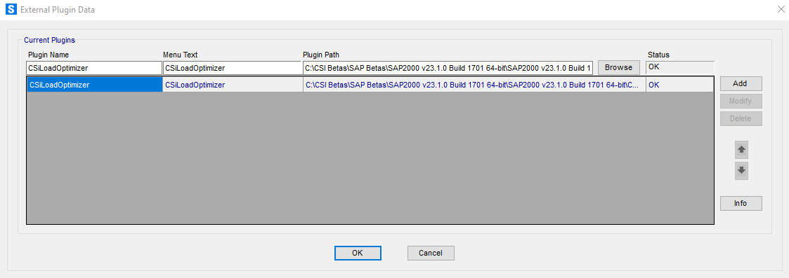

# Information for Plugin Developers

This topic contains the following sections:

- [Plugin Considerations](#Plugin_Considerations:_)
- [The cPlugin Class](#The_cPlugin_Class:)
- [Adding Plugins](#Adding_Plugins)

As an alternative to external API clients, plugins that are accessible via SAP2000 menus can be developed to make use of the SAP2000 API from inside the program.

No license is required to use the API for plugin development, beyond having a valid license for SAP2000 or CSiBridge. However, technical support for developing with the API is not included. For qualified users and third-party developers who would like technical support to help them build solutions and integrations with SAP2000 using the SAP2000 API, Computers and Structures, Inc., has created a subscription-based service, CSI Developer Network (CSIDN)  (see <https://www.csiamerica.com/support>). You would need to subscribe to CSIDN to be eligible for technical support for SAP2000 API.

Plugins can be developed in a .NET compatible language (e.g. Visual Basic, C#, etc.), as a .NET DLL, or by using any language capable of creating a COM server compiled as a DLL. An example plugin project can be found at [CSI Knowledge Base Sample Plugins](https://redirects.csiamerica.com/wiki/x/cod0)

## <a id="Plugin_Considerations:_"></a>Plugin Considerations:

### <a id="General_"></a>General

The plugin must reference the SAP2000v1 API library (either SAP2000v1.dll for .NET based or SAP2000v1.tlb for COM based plugins), which must be registered on the developer’s and the user’s systems. This registration takes place during the installation of SAP2000, but can be repeated whenever necessary by running the RegisterSAP2000.exe utility included in the program installation folder.

The SAP2000 program targets .NET 8 and is compatible with 64-bit and AnyCPU-compiled plugins referencing SAP2000v1.dll and targeting .NET Standard 2.0, .NET Framework 4.6.1 and newer (including the latest - 4.8.1), .NET Core/.NET 2.0 and newer (including the latest - 8.0) along with 64-bit plugins exposed as COM objects. Any kind of 32-bit plugins are not supported.

Please make sure your plugin is stable, handles errors well, and does not cause any unintended changes to the user’s model as actions performed by plugins are not undoable.

We will attempt to maintain a stable interface in SAP2000, however, that cannot be guaranteed, and updates to your plugin may be required for future versions of SAP2000.

### <a id="Plugins Targeting .NET Framework_"></a>Plugins Targeting .NET Framework

Please note that plugins targeting .NET Framework

- Should NOT use .NET Framework technologies unavailable on .NET. See <https://learn.microsoft.com/en-us/dotnet/core/porting/net-framework-tech-unavailable> for details.
- Should NOT include SAP2000v1.dll in the plugin folder to prevent conflicts with SAP2000v1.dll located in the program folder.

### <a id="Plugins Targeting .NET Core/.NET_"></a>Plugins Targeting .NET Core/.NET

Please note that plugins targeting .NET Core/.NET

- Should NOT include SAP2000v1.dll in the plugin folder to prevent conflicts with SAP2000v1.dll located in the program folder.
- Should include all other dependencies of the plugin in the plugin folder.

See <https://learn.microsoft.com/en-us/dotnet/core/tutorials/creating-app-with-plugin-support#simple-plugin-with-no-dependencies> for details.

### <a id="Plugins Exposed as COM Objects_"></a>Plugins Exposed as COM Objects

Please note that plugins exposed as COM objects

- Must be registered for COM on the user’s system, preferably after SAP2000 has been installed.
- Will require administrative rights to register, which many end users may not have.

It is the plugin developer's responsibility to instruct users how to install the plugin.

### <a id="Plugin Compatibility_"></a>Plugin Compatibility

Please consider the following recommendations when implementing a plugin based on the plugin's functionality and its target audience.

- For simple plugins with no user interface, targeting .NET Standard 2.0 should ensure maximum compatibility with old, current, and future versions of SAP2000.
- For more complex plugins with a user interface, targeting .NET Framework 4.8 should ensure maximum compatibility with old, current, and future versions of SAP2000, provided that the plugin does not use .NET Framework technologies unavailable on .NET.
- For plugins meant to be used with SAP2000 v26.0.0 and later, targeting .NET 8 should enable latest .NET functionality while ensuring maximum compatibility with current and future versions of SAP2000.
- Plugins developed using native languages like C, C++, can be exposed as COM objects. Unlike plugins targeting a version of .NET, plugins exposed as COM objects will need to be registered before they can be used.

## <a id="The_cPlugin_Class:"></a>The cPlugin Class:

In order for SAP2000 to be able to launch your plugin, your plugin assembly must contain a class called cPlugin that implements the cPluginContract interface in the SAP2000 API.

Please refer to the [cPluginContract](../SAP2000_API_Fuctions/PlugIns/cPluginContract_Methods/cPluginContract.md) page for an explanation of its methods. They are also described below.

Class cPlugin  must contain two methods, cPlugin.Info and cPlugin.Main


```
Public Function Info(ByRef Text As String) As Integer

```


The function cPlugin.Info has one reference argument, Text, and returns a 32-bit signed integer. The return value should be zero if successful. The string argument should be filled in by the function, and may be plain text or rich text. This string will be displayed when the user first adds the plugin to SAP2000. You can use this string to tell the user the purpose and author of the plugin. This is in addition to any information you may provide when the user executes the plugin.


```
Public Sub Main(ByRef SapModel As SAP2000v1.cSapModel, ByRef ISapPlugin As SAP2000v1.cPluginCallback)

```


The subroutine cPlugin.Main is the entry point to launch your plugin. All functionality in your plugin will proceed from this method. If your plugin has an initial form, it should be opened within this method.

cPlugin.Main has two reference arguments of types SAP2000v1.cSapModel and SAP2000v1.cPluginCallback:

The SapModel argument is a reference to the SapModel object upon which all operations will be performed

For the ISapPlugin argument, please refer to the  [cPluginCallback](../SAP2000_API_Fuctions/PlugIns/cPlugincallback_Properties/cPluginCallback_Interfacey.md)  page for an explanation of its properties. Its only method is very important and explained below.


```
SAP2000v1.cPluginCallback.Finish(ByVal iVal As Integer)

```


SAP2000v1.cPluginCallback contains a Finish  subroutine that is to be called immediately before the plugin closes (e.g., if the plugin has a single main window, at the end of the close event of that form). Its one argument, iVal, is an error flag to let SAP2000 know if the operation was successful or not. Zero indicates no error. SAP2000 will wait indefinitely for SAP2000v1.cPluginCallback.Finish to be called, so the plugin programmer must make sure that it is called when the plugin completes

It is OK for  cPlugin.Main  to return before the actual work is completed (e.g., return after displaying a form where the functionality implemented in the plugin can be accessed through different command buttons). However, it is imperative to remember to call  SAP2000v1.cPluginCallback.Finish  to return the control back to SAP2000 when the plugin is ready to close.

Your plugin should include options for the user to obtain information about the product, developer, and technical support. Support for your plugin will not be provided by Computers and Structures, Inc.

As currently implemented, the cPlugin object will be destroyed between invocations from the SAP2000 Tools menu command that calls it, so data cannot be saved.

## <a id="Adding_Plugins"></a>Adding Plugins



### Adding a COM Plugin

To add a COM plugin to the Tools menu in SAP2000, users will select "Add/Show Plugins" from the Tools menu. In the External Plugin Data form, they will type the name of the COM server DLL in the "Plugin Name" field.

Please note that SAP2000 will look for the plugin by Type Library name (usually the name of the plugin project), which you define when developing your COM server DLL. We suggest using a unique name such as SAP2000PlugIn\_xxx\_yyy, where xxx is your (company) name, and yyy is the name to distinguish the plugin from other plugins that you develop, e.g. SAP2000PlugIn\_OmniCorp\_Robo1.

The "Plugin Name" must exactly match the COM server DLL name. However, the plugin will appear under the Tools menu under the "Menu Text" name. That can be whatever the user likes, but it should be different for each plugin added.

The "Plugin Path" field should be left blank for COM plugins.

After clicking the "Add" button, the "Status" field will indicate whether the plugin was successfully located in the registry and loaded.

### Adding a .NET Plugin

The process for adding a .NET plugin is much simpler. In the External Plugin Data form, the user should simply browse for and select the plugin .NET DLL and click the "Add" button. The rest of the fields will be automatically populated. It is still recommended that .NET plugins be given unique names.
