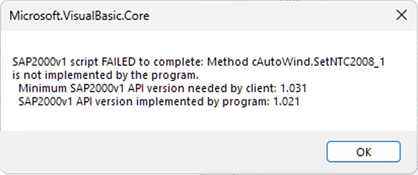

# Update to .NET Standard 2.0

With the release of SAP2000 v26.0.0, the API is compiled as a .NET Standard 2.0 AnyCPU dynamic link library (DLL) and supports an increased range of 32-bit and 64-bit API clients targeting .NET Framework 4.6.1 and newer (including the latest - 4.8.1), .NET Core/.NET 2.0 and newer (including the latest - 8.0), along with clients accessing the API via COM. While the file version of the library has been incremented to 2.0.0, the name of the library remains the same, **SAP2000v1.dll**, and source code compatibility with earlier versions is preserved.

Most API developers should be able to update their client applications to reference the latest API without significant disruption, and are encouraged to do so for maximum compatibility with old, current, and future versions of SAP2000. Please refer to the provided examples to see if your client application requires any code changes.

## Forward Compatibility

.NET based client applications referencing older versions of the API library (file version < 2.0.0) **will no longer work with SAP2000 v26.0.0 and newer.** Client applications accessing the API via COM will continue to work. API developers are encouraged to update their clients to reference the latest API for maximum compatibility with old, current, and future versions of SAP2000.

## Backwards Compatibility and Error Handling

.NET based client applications referencing the latest version of the API library and client applications accessing the API via COM are both expected to work with old, current, and future versions of SAP2000 and API developers are encouraged to update their clients to reference the latest API.

Client applications that use the new API library will also benefit from improved error handling. When trying to use a function that is not supported in the version of SAP2000 to which they are connected, a catchable exception with an informative error message will be thrown:

## Remote API Disabled

The Remote API feature, used to start and/or connect to a running instance of SAP2000 on a Remote Computer, has been disabled with the release of SAP2000 v.26.0.0. This functionality may be added back to the program in a future release. Please refer to the page, Breaking changes in v26.0.0

## Late Binding in VBA Disabled

In SAP2000 v26.0.0 and later, the API is compiled as a .NET Standard 2.0 AnyCPU dynamic link library (DLL). Previously it had been compiled as a .NET Framework 4.7.1 AnyCPU DLL. Due to that change, certain late binding VBA calls that may have worked in earlier versions of the API will no longer work. CSI recommends using early binding for VBA, and all other, API client applications, as documented in this help file.
