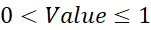
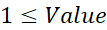

# SetPreference

## Syntax

SapObject.SapModel.DesignColdFormed.AISI\_16.SetPreference

## VB6 Procedure

Function SetPreference(ByVal Item As Long, ByVal Value As Double) As Long

## Parameters

Item

This is an integer between 1 and 14, inclusive, indicating the preference item considered.

1 = Framing type

2 = Demand/capacity ratio limit

3 = Second order method

4 = Design provision

5 = Lateral factor

6 = Use lateral factor

7 = PhiTy resistance or OmegaTy safety factor

8 = PhiTr resistance or OmegaTr safety factor

9 = PhiC resistance or OmegaC safety factor

10 = PhiB resistance or OmegaB safety factor

11 = PhiBPipe resistance or OmegaBPipe safety factor

12 = PhiV resistance or OmegaV safety factor

13 = Time history design

14 = Pattern live load factor

Value

The value of the considered preference item.

1 = Framing type

1 = Moment Frame

2 = Braced Frame

2 = Demand/capacity ratio limit

Value > 0

3 = Second Order Method

1 = General 2nd Order

2 = Amplified 1st Order

4 = Design Provision

1 = LRFD

2 = ASD

3 = LSD

5 = Lateral Factor

Value > 0

6 = Use Lateral Factor

1 = No

2 = Yes

  

7 = PhiTy resistance or OmegaTy safety factor

PhiTy:         

OmegaTy:   

8 = PhiTr resistance or OmegaTr safety factor

PhiTr:         

OmegaTr:   

9 = PhiC resistance or OmegaC safety factor

PhiC:         

OmegaC:   

10 = PhiB resistance or OmegaB safety factor

PhiB:         

OmegaB:   

11 = PhiBPipe resistance or OmegaBPipe safety factor

PhiBr:         

OmegaBr:   

12 = PhiV or OmegaV safety factor

PhiV:         

OmegaV:   

13 = Time history design

1 = Envelopes

2 = Step-by step

14 = Pattern live load factor

Value > 0

If Design Provision is 1 (LRFD) or 3 (LSD), Phi factors will be set to have value of items 7 through 12. Otherwise, if Design Provision is 2 (ASD), Omega factors will be set to have value of items 7 through 12.

## Remarks

This function sets the value of a cold formed design preference item.

The function returns zero if the item is successfully set; otherwise it returns a nonzero value.

## VBA Example


```
Sub SetColdFormedDesignPreferenceItemAISI_16()

       'dimension variables

          Dim SapObject as cOAPI

          Dim SapModel As cSapModel

          Dim ret As Long

          Dim Name As String


       'create Sap2000 object

          Set SapObject = CreateObject("CSI.SAP2000.API.SapObject")


       'start Sap2000 application

          SapObject.ApplicationStart


       'create SapModel object

          Set SapModel = SapObject.SapModel


       'initialize model

          ret = SapModel.InitializeNewModel


       'add cold formed material

          ret = SapModel.PropMaterial.AddQuick(Name, MATERIAL_COLDFORMED, , , , MATERIAL_COLDFORMED_SUBTYPE_ASTM_A653SQGr50)


       'create new cold formed frame section property

          ret = SapModel.PropFrame.SetColdC("CdC", Name , 9, 3, 0.06, 0.25, 0.5)


       'create model from template

          ret = SapModel.File.New2DFrame(PortalFrame, 2, 72, 2, 144, True, "CdC", "CdC")


       'set coldformed design code

          ret = SapModel.DesignColdFormed.SetCode("AISI-16")


       'set preference item

          ret = SapModel.DesignColdFormed.AISI_16.SetPreference(1, 2)


       'close Sap2000

          SapObject.ApplicationExit False

          Set SapModel = Nothing

          Set SapObject = Nothing

    End Sub
  
```


## Release Notes

Initial release in version 22.2.0.

Added item 14 version 27.0.0.

## See Also

[GetPreference](GetPreference.md)
